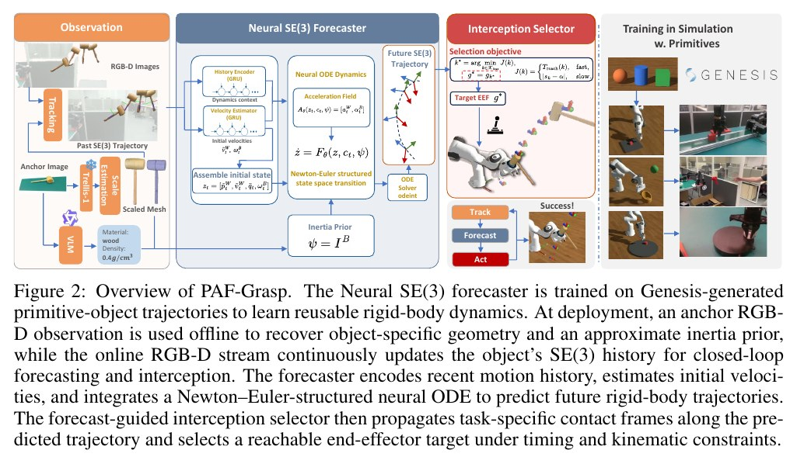
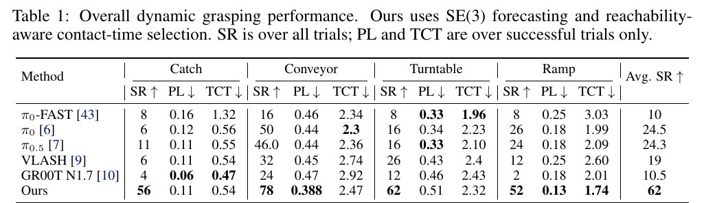
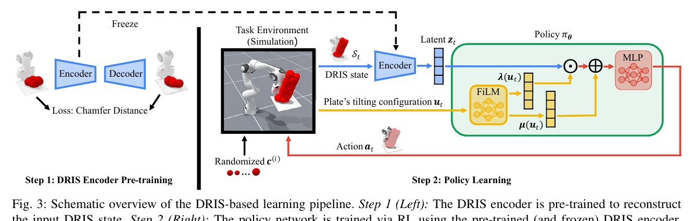
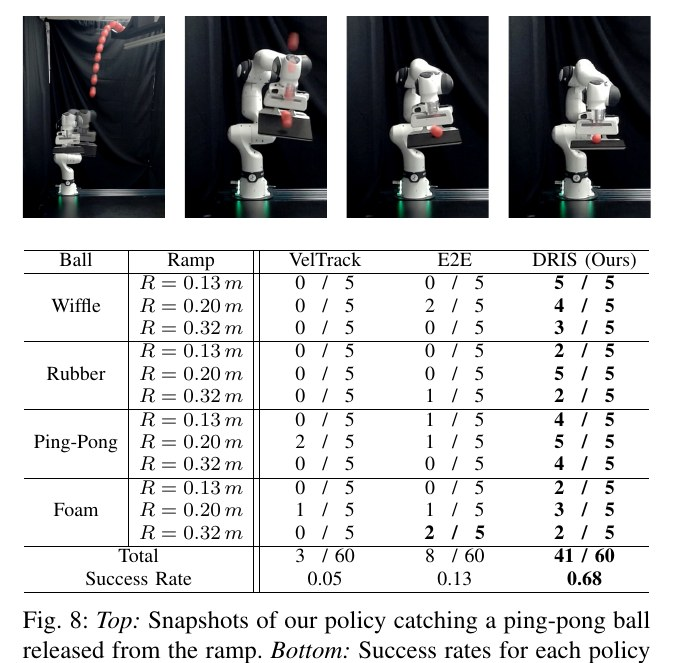

# Ego Catching Research Radar · 2026-10-19

本期 2 篇全文精读、2 组补充资源。
Physics-Aware Object-Centric SE(3) Forecasting for Real-Time Proactive Dynamic Grasping：论文针对动态物体的主动拦截与抓取问题，提出“预测再选择”（forecast-then-select）范式。证据边界：实机高速抛掷验证退化为仅预测球体3D中心坐标的接球任务，而对需要完整SE(3)姿态对齐的非对称物体（如抛铁锤），实机测试受限于RGB-D运动模糊与跟踪失效而未给出系统性成功率。
Zero-Shot Sim-to-Real Robot Learning: A Dexterous Manipulation Study on Reactive Catching：论文针对无被动几何约束（无凹槽、球网或夹爪，仅用刚性平板）的高动态非抓取接球与稳定平衡任务。证据边界：理论分析建立在策略直接观测完整实例集合状态的假设上，而实际部署时是将单个真实观测（N=1）输入给用 N=200 样本预训练的编码器，论文未评估这种输入集合尺寸不一致所带来的潜在表征分布偏移；若能提供编码器隐空间在 N=1 与 N>1 下的对齐度分析，或补充直接使用状态统计量（如均值与方差）的无自编码器基线，将能确认该表征压缩环节的必要性与影响。

## 1. Physics-Aware Object-Centric SE(3) Forecasting for Real-Time Proactive Dynamic Grasping

**作者：** Yirui Zhou, Hongli Xu, Ying Zheng, Yi Wang, Lap-Pui Chau
**单位：** The Hong Kong Polytechnic University; Technical University of Munich
**发表与版本：** arXiv preprint · 2026-10-13

**选题定位：** 核心相关工作

[arXiv](https://arxiv.org/abs/2610.17843v1) · [PDF 下载](https://arxiv.org/pdf/2610.17843v1) · [Project](https://am0rarg0.github.io/paf-grasp/)

### Problem formulation

论文针对动态物体的主动拦截与抓取问题，提出“预测再选择”（forecast-then-select）范式。系统在每个控制周期根据历史时域观测估计物体位姿序列，未知量为物体未来的连续刚体运动轨迹及其与机械臂末端可达性匹配的接触时刻与构型。动作输出为满足运动学、工作空间、避障及系统延迟约束的最优末端执行器接触位姿目标；优化目标是最小化到达时间或指定接触相位误差。关键假设为被抓取物为单体刚体，其几何与粗略惯量可通过初始单视角离线估计获得，且运动过程满足连续牛顿-欧拉动力学。

**观测与动作／训练和部署的区别：** 真实实验中使用AgileX Piper轻型机械臂（100 Hz底盘与关节控制）及单台Intel RealSense D435i RGB-D相机（固定外部视角，未采用手眼相机）。在部署前，利用单张RGB-D锚点图像通过SAM2、TRELLIS-1及Qwen3-VL-30B推断物体的米制网格、材质类别与刚体惯量先验；在线执行时，RGB-D数据流通过FoundationPose++（旋转/传送带任务，约20 Hz）或Cutie+深度恢复（抛物小球，无方向要求）实时输出SE(3)轨迹历史（以10 Hz重新触发预测并以100 Hz下发至低层控制）。仿真中Catch任务采用两台固定外部相机，其他任务则通过仿真器直接提供物体位姿。末端动作形式为6-DoF位姿设定点配合二指夹爪开合或固定手持网兜接收。

### Pipeline 与关键方法

PAF-Grasp系统完整流程图。左侧展示离线阶段利用单张RGB-D锚点图像通过SAM2分割、TRELLIS-1几何重建与Qwen3-VL密度推断获取米制网格与刚体惯量先验I^B；中间核心为基于牛顿-欧拉结构的神经ODE预测器，通过双GRU处理历史位姿与速度，并在连续时间积分输出未来SE(3)轨迹；右侧拦截选择器结合机械臂运动学与延迟裕量评估可达集并选择最优接触点。
[原图来源：Figure 2](https://arxiv.org/pdf/2610.17843v1#page=4)

| 模块 | 输入 → 输出 | 关键方法与作用 |
|---|---|---|
| 离线物理先验构建 (Offline Prior Recovery) | 输入单张锚点RGB-D图像 -> 输出物体的米制3D网格及机体坐标系下的转动惯量张量先验 I^B | SAM2分割 + TRELLIS-1网格生成 + OnePoseViaGen尺度对齐 + Qwen3-VL密度估计 |
| 在线状态估计与上下文编码 (Online State & Context Encoding) | 输入长度为K的SE(3)位姿历史 H_t -> 输出相对运动初状态 z_t=[p~, v~, q~, ω^B] 及环境上下文向量 c_t | 双GRU结构：Velocity Estimator平滑估计初速度，History Encoder提取动力学上下文 |
| 神经ODE动力学前向推演 (Neural ODE Dynamics Rollout) | 输入初状态 z_t、上下文 c_t 与惯量 I^B -> 输出未来H步长时域SE(3)刚体位姿轨迹 Y^_t | MLP拟合牛顿-欧拉结构下的加速度场 A_θ(z, c, I^B)，结合Dopri5常微分方程数值积分器连续时间推演 |
| 可达性感知接触选择 (Reachability-Aware Interception Selector) | 输入未来预测接触位姿序列 {g_k} 与当前机械臂末端状态 -> 输出最终执行目标 g* 及其接触时刻 τ_k* | 运动学逆解 (IK)、线/角速度上限及系统延迟 (T_lat=0.1s, T_margin) 过滤可行候选集，再按极小时间或接触相位代价择优 |

**训练数据与监督：** Neural ODE预测器在Genesis物理仿真引擎中基于球体、长方体、圆柱体等几何基元生成的纯刚体动力学轨迹进行训练（抛物、传送带、转盘、斜面各生成1000条轨迹，下采样至Δt=0.05s）。训练仅使用SE(3)位姿序列及差分速度，完全不输入RGB或深度图像。损失函数由位置MSE、速度MSE及四元数弦长距离构成，权重为(1, 1, 0.05)，采用AdamW优化器训练3000 epochs。真实部署时完全冻结网络权重（零样本迁移），仅靠离线估计的几何网格与惯量张量适配真实物体；单次ODE预测推演耗时约15 ms。

### 实验结果及分析

仿真环境下4类动态抓取任务（抛物接球Catch、传送带Conveyor、转盘Turntable、斜面下滑Ramp）的定量对比结果。表中报告了所有试验的整体成功率（SR %，越大越好），以及仅在成功试验下的路径长度（PL m）与完成时间（TCT s）。PAF-Grasp在所有任务上均大幅压制包括π0、π0.5、GR00T N1.7在内的反应式基线，整体平均成功率从24.5%飞跃至62.0%。
[原图来源：Table 1](https://arxiv.org/pdf/2610.17843v1#page=7)

- 在Genesis仿真4项动态任务中，PAF-Grasp平均成功率从最强基线（π0的24.5%）显著提升至62.0%，抛物接球从11%提升至56%，转盘抓取从26%提升至62%，传送带与斜面分别达到78%和52%（π0对应为50%与26%）。 Section 4.1, Table 1 [原文](https://arxiv.org/pdf/2610.17843v1)
- 真实机械臂测试中（每项任务50次），PAF-Grasp对比结合实时分块（RTC）的微调π0.5基线：抛物小球接取成功率64% vs 0%，传送带抓取78% vs 34%，转盘旋转杯把抓取60% vs 12%。 Section 4.1, Figure 3(a) [原文](https://arxiv.org/pdf/2610.17843v1)
- 在接触相关未来预测质量上，PAF-Grasp预测轨迹渲染掩码与真值的mIoU达到0.2762，耗时仅15 ms；而视频生成大模型CogVideoX（mIoU 0.0036/180s）、Wan 2.2（0.0225/41s）、Veo 3.1（0.0334/71s）及Kling 3.0（0.0466/30s）精度极低且严重滞后，即使输入多帧时序上下文的3DScenePrompt也仅达到0.0584 mIoU。 Section 4.2, Table 2 & Table 9 [原文](https://arxiv.org/pdf/2610.17843v1)
- 在考虑真实含噪SE(3)输入的消融中，NODE预测器相较于特定任务经典解析预测器（抛物为弹道模型、传送带为匀速、转盘为已知中心圆周运动），在4类任务中均大幅降低最终旋转误差（Rot-FDE降至0.51°~10.64°，经典方法为6.24°~12.99°），平均拦截成功率由57%提升至62%。 Section 4.3, Table 3 [原文](https://arxiv.org/pdf/2610.17843v1)
- 在超出监督视界的外推测试中（H>20步至40步），自回归Transformer（AR）的位置与角度误差呈发散式指数上升，而Neural ODE预测器保持近似线性的平缓误差增长。 Section 4.3, Figure 7 [原文](https://arxiv.org/pdf/2610.17843v1)

实验强有力地支持了以下论点：对于动态操作，将状态空间压缩为接触相关的SE(3)刚体动力学流形，无论在实时性（15 ms对比视频模型的数十秒）、物理一致性还是外推稳定性上均远优于密集像素级世界模型；同时，显式解耦‘轨迹预测’与‘逆运动学可达性时间点选择’，从根本上克服了反应式VLA策略因传感器与执行延迟导致的‘追逐过时状态’（Lagging/Stale Pose）失效。然而，该文的实验局限亦十分明显：其一，抛物实机实验简化为球体与网兜捕获，避开了高转速非对称物体（如带自旋铁锤）在接触瞬间的夹爪闭合碰撞与反弹保持；其二，真实实验采用固定的外部全局相机，完全规避了手眼相机在机械臂剧烈机动时遭遇的严重运动模糊、深度缺失与视野丢失（FOV脱离）；其三，惯量先验高度依赖大语言模型对均质材质密度的粗略猜测，对质量分布非均匀或复合材质物体泛化能力存疑。

### Robotics reviewer judgment

- **实际贡献：** 该论文提出了PAF-Grasp框架，将动态抓取解耦为目标物体的SE(3)轨迹预测与可达性拦截点选择两个阶段。方法在仿真中使用基础几何体与随机化刚体动力学训练基于神经常微分方程（Neural ODE）并结合转动惯量先验的预测器，并在实机中结合离线网格与密度估计以及在线RGB-D 6D位姿跟踪实现闭环预测与轨迹选择。
- **最强证据：** 在AgileX Piper机械臂及外部Realsense D435i相机的实机测试中（每项任务50次试验），该方法在抛球接取（64%）、传送带拦截（78%）和转盘抓取（60%）上均高于微调的pi_0.5基线。仿真实验显示预测模块单次推理耗时约15毫秒，在四类动态任务上取得了62.0%的平均抓取成功率。
- **证据缺口：** 实机高速抛掷验证退化为仅预测球体3D中心坐标的接球任务，而对需要完整SE(3)姿态对齐的非对称物体（如抛铁锤），实机测试受限于RGB-D运动模糊与跟踪失效而未给出系统性成功率。若能补充高动态旋转工况下跟踪误差分布对抓取成功率影响的量化曲线，或在具备完整姿态约束的高速实机拦截中验证，将明确该感知-预测链条的实际适用边界。
- **比较是否公平：** 论文既对比了外部基线（包括微调的pi_0、pi_0.5、Fast-WAM以及视频生成大模型），也进行了内部消融（Neural ODE与自回归Transformer、惯量先验消融及经典解析动力学预测器）。权衡方面，在斜坡滑落这一已知运动结构的仿真任务中，经典解析预测器的成功率高于所提Neural ODE预测器（60%对52%），表明所学模型在特定结构化动力学下相比显式物理规则并不具全面优势。
- **总体判断：** 实验支持了将动态抓取建模为SE(3)状态预测与可达时间窗口选择相较于端到端反应式策略及像素级视频预测具有更高的任务成功率与实时性。但该系统对外部RGB-D姿态跟踪质量与刚体单材质假设存在较强依赖，在复杂质量分布、接触碰撞突变及高速视觉模糊场景下的鲁棒性仍有待解决。

**对 OpenArm 的启发与最小实验：** 对OpenArm在本体搭载RGB-D相机进行动态截击与抓取的工程迁移建议：1. 核心迁移点：引入其‘连续时间ODE加速度场预测 + 可达时窗截击点过滤（Eq. 4-5）’作为中间规划层，替代由网络直接端到端输出关节动作的脆弱模式，能有效补偿至少100 ms的感知与控制环路延迟；2. 关键差距与风险：OpenArm手眼相机在机械臂高速挥动前往截击区时会产生强烈的自身运动视差和卷帘快门模糊，FoundationPose++极易发生跟踪漂移甚至跟踪丢失，需在前端融合IMU本体动觉或补足事件相机（如文中提及的Event6D）进行位姿卡尔曼平滑；3. 最低验证实验：在Isaac Gym或MuJoCo中搭建OpenArm模型，设置末端搭载D435i深度相机，让传送带匀速送来立方体，在手眼闭环跟踪下对比‘反应式追逐当前位姿’与‘PAF-Grasp预测拦截选择’在机械臂速度/加速度极限约束下的拦截成功率与超调量。

## 2. Zero-Shot Sim-to-Real Robot Learning: A Dexterous Manipulation Study on Reactive Catching

**作者：** Kejia Ren, Gaotian Wang, Andrew S. Morgan, Kaiyu Hang
**单位：** Rice University; Robotics and AI Institute
**发表与版本：** arXiv preprint (Accepted to RSS 2026) · 2026-05-10

**选题定位：** 核心相关工作

[arXiv](https://arxiv.org/abs/2605.09789v1) · [PDF 下载](https://arxiv.org/pdf/2605.09789v1) · [Project](https://rice-robotpi-lab.github.io/DRIScatch/)

### Problem formulation

论文针对无被动几何约束（无凹槽、球网或夹爪，仅用刚性平板）的高动态非抓取接球与稳定平衡任务。系统观测为在初始球入射平面对齐的动态运动坐标系下的球相对平板中心位移与线速度 $s_t=(d_t, v_t)\in\mathbb{R}^6$；未知量包括来球恢复系数、接触摩擦、球半径及观测/控制延迟；策略输出动作 $a_t=(\delta_t, u_t)\in\mathbb{R}^5$（平板中心位移增量与倾角法向）。目标是在零样本 Sim-to-Real 迁移下吸收碰撞动能，并在无机械凹陷协助下使小球速度衰减至静态平衡且不掉落平板。

**观测与动作／训练和部署的区别：** 仿真与真机部署存在感应配置差异：真实部署中未在机械臂末端使用机载相机，而是由工作空间外部两台 80 FPS 工业相机进行实时颜色分割、轮廓拟合、双目三角定位与抛物线拟合（并以 0.1s 滑动窗口 OLS 估计速度），结合关节编码器提供机械臂关节状态 $q, \dot{q}$；执行机构为 7-DoF Franka Research 3 (FR3) 机械臂，末端刚性安装覆盖氯丁橡胶阻尼垫的 3D 打印平整平板（半长 12 cm）；策略以 20 Hz 生成期望平板位姿，经解析 IK 解算为目标关节角 $\tilde{q}_t$，最终由关节空间阻抗/力矩控制器驱动，无前馈惯量项。

### Pipeline 与关键方法

DRIS 框架的两阶段学习管线流程图。Step 1（左侧）：利用随机探索收集的物理参数随机化实例集合，基于 Chamfer 距离无监督预训练 PointNet 架构的 6D 实例集自编码器并冻结权重；Step 2（右侧）：在仿真环境中，每个训练轮次独立采样 N 个球体物理属性，将实例集合状态 St 输入冻结编码器压缩为隐向量 zt，随后利用平板实时倾角 ut 经由 FiLM 进行特征调制，由 MLP 动作网络输出位移与法向动作 at。该图说明了多参数实例如何在共享动作下交互，但未展现真机外部双目感知的解算过程。
[原图来源：Fig. 3](https://arxiv.org/pdf/2605.09789v1#page=5)

| 模块 | 输入 → 输出 | 关键方法与作用 |
|---|---|---|
| 动态运动坐标系投影 (Motion Frame Invariant Projection) | 输入基坐标系下球位置 $p^o_t$、速度 $v^o_t$ 与平板初始位置 $p^e_0$，输出旋转对齐至来球方向的运动系状态 $s_t=(d_t, v_t)\in\mathbb{R}^6$ 及平板倾角 $u_t=(\alpha_t, \beta_t)$。 | 几何对齐与相对运动变换 |
| DRIS 多实例分布编码 (DRIS Belief Compression) | 输入仿真训练时 $N$ 个并行物化实例的状态集合 $S_t\in\mathbb{R}^{N\times 6}$（真机推理时退化为 $N=1$ 的单点集），输出固定维度紧凑隐空间特征 $z_t\in\mathbb{R}^{64}$。 | 预训练 PointNet 架构的 6D 点集自编码器 (1D Conv + Max-Pooling + Chamfer Distance 重建损失) |
| 物理感知特征调制与策略推理 (FiLM-Conditioned Policy) | 输入隐向量 $z_t$ 与平板倾角参数 $u_t$，经尺度与偏置调制 $\tilde{z}_t = \lambda(u_t)\odot z_t + \mu(u_t)$ 后送入 MLP，输出动作 $a_t=(\delta_t, u_t)\in\mathbb{R}^5$。 | 特征级线性调制 (FiLM) + MLP |
| 末端轨迹跟踪与力矩控制 (Low-Level Torque Control) | 输入动作 $a_t$ 计算末端期望位姿 $T^e_t\in SE(3)$，解算目标关节角 $\tilde{q}_t$，输出关节力矩 $\tau = K(\tilde{q}_t - q) - D\dot{q} + C(q, \dot{q}) + g(q)$。 | 罗德里格斯公式位姿变换 + 逆运动学 (IK) + 关节空间 PD 阻抗力矩控制 |

**训练数据与监督：** 训练在 GPU 并行物理引擎 ManiSkill 中完成（128 个并行环境，单个 RTX 3060 12GB 显卡）。两阶段训练：第一阶段在随机动作下采样 128,000 个 200-实例的 DRIS 样本，以 Chamfer 距离为损失预训练 6D PointNet 自编码器 100 epochs（耗时约 10 分钟）；第二阶段冻结编码器 $\psi$，以 PPO 算法对策略网络进行 1000 epochs 强化学习（耗时约 2 小时）。DRIS 采样参数范围：球半径 [2, 4] cm、动静摩擦系数 [0, 0.1]、弹性恢复系数 [0.4, 0.7]。训练时环境中关闭实例间碰撞及球与臂身连杆碰撞，仅保留球板触碰；仿真无特权状态透传至部署，真机推理直接使用 $N=1$ 单实例点集输入已冻结编码器。

### 实验结果及分析

实机接球实验结果汇总。上方展示了机械臂平板成功拦截并稳定平衡从倾斜导轨释放的乒乓球的连续动作切片；下方表格对比了启发式基线 VelTrack、单实例强化学习 E2E 与本方法 DRIS 在 4 种球体（多孔硬球、橡胶球、乒乓球、海绵球）及 3 种曲率释放斜坡下的成功率统计（每组 5 次，总计 60 次）。DRIS 取得了 68% 的总成功率，显著超越基线的 5% 与 13%，但在低摩擦易滚动的海绵球和部分高速释放下仍有脱落。
[原图来源：Fig. 8](https://arxiv.org/pdf/2605.09789v1#page=8)

- 真实机械臂 60 次斜坡释放接球实验中，DRIS(N=200) 策略取得 41/60 成功率 (68%)，显著高于启发式速度跟踪基线 VelTrack (3/60, 5%) 与传统单实例端到端强化学习 E2E (8/60, 13%)。四个测试球种中，DRIS 在多孔硬球 (Wiffle) 达 12/15 (80%)，乒乓球达 13/15 (87%)，橡胶球达 9/15 (60%)，泡沫球达 7/15 (47%)。 Section VI-B, Fig. 8 (table & text) [原文](https://arxiv.org/pdf/2605.09789v1)
- 在仿真极端观测噪声对比中（基础标准差 $\sigma$: 位置 1 cm、速度 5 cm/s，注入倍数 1 到 4），当噪声提升至 $4\sigma$ 时，E2E 与 DRIS(N=1) 成功率骤降至接近 0，而 DRIS(N=10/50/200) 成功率仍稳定维持在 0.7 左右；长期训练中 E2E 出现明显过拟合衰退，DRIS 表现出强抗噪单调收敛性。 Section V-B, Fig. 4(a)-(b) [原文](https://arxiv.org/pdf/2605.09789v1)
- 在计算可扩展性实验中，在 $2\sigma$ 观测噪声下，将传统 E2E 基线暴力扩展到 128×50 单球独立环境（匹配球交互总数）使其成功率从 0.55 升至 0.73，显存从 0.65GB 暴增至 2.0GB；而 DRIS(N=50) 仅消耗 0.71GB 显存即可达到 0.89 成功率，证明多实例共享动作演化具更高样本与计算效率。 Section V-C (text) [原文](https://arxiv.org/pdf/2605.09789v1)
- 分布外 (OOD) 物理泛化验证：在训练弹性恢复系数严格限制在 [0.4, 0.7] 的前提下，针对 [0.7, 0.8] 高弹性小球进行测试，E2E 成功率仅约 0.62，而 DRIS(N=50/200) 成功率超过 0.82。 Section V-B, Fig. 6 [原文](https://arxiv.org/pdf/2605.09789v1)

实验表明：(1) 在接触力学极端敏感的平板非抓取接球中，单实例域随机化 (DR) 仅能覆盖静态参数采样，无法约束动作在动态演化过程中的后验分散度，优化梯度易被一阶噪声湮没；(2) DRIS 通过单步共享动作推进整个粒子群，从理论上推导出了对物理方差 $\mathrm{Tr}(H_t \Sigma_t)$ 的隐式二次正则项，促使策略主动收敛至对摩擦和弹性不敏感的低发散流形；(3) 失败案例主要归因于初始触碰未充分耗散来球动量、两台外部相机 80 FPS 采样与 0.1s 速度估计滑动窗口引入的测量时延，导致机械臂在补救追踪时逼近运动学或关节功率极限；(4) 局限在于 DRIS 强依赖系统动力学的能量耗散特性（dissipative dynamics），若扩展至能量注入任务（如高速抛掷），粒子状态发散会摧毁共享动作的可行性。

### Robotics reviewer judgment

- **实际贡献：** 该研究提出了一种名为 DRIS（Domain-Randomized Instance Set）的强化学习训练策略，在仿真中对多组随机物理参数实例施加同一动作并同步推进状态演化，利用预训练的点云自编码器将实例集合压缩为固定维度表征以优化策略。针对末端平板无被动机械限位的动态接球任务，方法结合 FiLM 姿态调制网络与逆运动学力矩控制，实现了不依赖真实世界微调的零样本策略部署。
- **最强证据：** 最直接的实验证据来自真实 7 自由度 Franka Research 3 机械臂的定量接球实验：通过外部双相机以 80 FPS 估计球体轨迹并由机外 CPU 进行 20 Hz 控制推理，系统在 4 种小球与 3 种滑轨速度组合的 60 次测试中实现了 68%（41/60）的成功率，显著高于单球训练基线；仿真实验也直接验证了实例数量（如 N 从 1 增至 200）对观测噪声和执行误差鲁棒性的递增增益。
- **证据缺口：** 理论分析建立在策略直接观测完整实例集合状态的假设上，而实际部署时是将单个真实观测（N=1）输入给用 N=200 样本预训练的编码器，论文未评估这种输入集合尺寸不一致所带来的潜在表征分布偏移；若能提供编码器隐空间在 N=1 与 N>1 下的对齐度分析，或补充直接使用状态统计量（如均值与方差）的无自编码器基线，将能确认该表征压缩环节的必要性与影响。
- **比较是否公平：** 论文的定量基准主要为内部消融版本（包括不同实例规模 N=1, 10, 50, 200，以及无编码器的单球端到端强化学习基线 E2E）和一个启发式速度追踪控制器（VelTrack），并未对已发表的在线系统辨识或自适应域随机化方案（如 BayesSim 或 RMA）进行独立复现对比。在计算代价上，DRIS 在仿真显存占用上优于同等交互量的大规模环境并行，但以引入额外的两阶段点云自编码器离线预训练为代价，且各实例共享单一动作的设计难以稳定扩展到物理发散强烈的能量注入型任务。
- **总体判断：** 论文充分支持了在以能量耗散为主的平板接球任务中，通过并行多物理实例演化训练能够抑制优化方差并提升真实部署鲁棒性的结论。但由于真实部署高度依赖外部相机低延迟轨迹拟合与预先标定的控制器增益，且人手抛球与异形物体的定性演示仅展示了特定能力示例，该方法在复杂几何接触及非耗散动态操作中的通用性仍有待进一步验证。

**对 OpenArm 的启发与最小实验：** 对 OpenArm / OpenArmX 的直接迁移价值与限制：(1) **可迁移机制**：针对 OpenArm 执行器齿轮背隙大、电机频宽有限导致的末端抖动问题，DRIS 训练范式能直接促使策略生成对执行误差容忍度更高的柔顺阻尼动作；(2) **待验证瓶颈**：原机采用 7-DoF FR3 工业级机械臂与 20 Hz 力矩控制，而 OpenArm 通常采用位置/速度接口或低成本准直驱，其动力学响应与延迟明显更差；(3) **机载感知差异**：本工作依靠外部 80 FPS 固定相机与平移不变运动系，若 OpenArm 采用腕部/头部 Eye-in-Hand 相机，机械臂机身运动会带来强烈的自运动 (ego-motion) 光学畸变与视场截断，无法直接使用文中基于静态初始击球面的运动系投影；(4) **最小验证实验**：在 ManiSkill/IsaacGym 中构建 OpenArm 模型，末端加装接球托盘，先在仿真中注入 50ms 典型通信延迟与 0.05 rad 关节抖动，测试 DRIS (N=10) 是否能在托盘减速接球中抑制反弹脱轨。

## 补充研究资源

### ManiDreams: Uncertainty-aware Task-specific Intuitive Physics Planning Library

**形式：** code · **访问层级：** partial
**作者／单位：** Gaotian Wang, Kejia Ren, Andrew S. Morgan, Kaiyu Hang · Rice University (RobotPI Lab) & Robotics and AI Institute
**日期：** 2026-03-24

开源模块化不确定性规划库，支持在仿真和真实世界中基于采样-预测-约束循环评估候选动作分布，提供针对 pushing、picking 和 catching 的示例代码与物理仿真后端适配接口。

**研究启发：** 为 OpenArm 仿真接球及台面动态抓取提供了现成的分布不确定性前向传播与约束求解基线，可在无需重新训练端到端策略的情况下作为动作安全与可行性筛选器。

**中立判断：** 提供了规范的开源代码与示例任务实现，但库中的 catching 模块主要依赖外部低延迟物理/状态估计输入，未内嵌完整的机载 RGB-D 特征提取器。

[Access](https://github.com/Rice-RobotPI-Lab/ManiDreams) · GitHub 公开仓库，含 Python API 文档与示例脚本。 本次仅核验到搜索/部分页面材料，未取得完整正文访问记录；原文细节需回到来源核对。

[相关论文](https://arxiv.org/abs/2603.18336v2)

### AthenaZero: A low-inertia, bimanual robot for dynamic manipulation

**形式：** paper_link · **访问层级：** metadata_only
**作者／单位：** Andrew S. Morgan et al. · Robotics and AI Institute (RAI Institute)
**日期：** 2026-09-15

详细阐述了采用准直驱（QDD）低速比执行器与远端连杆轻量化配置的双臂系统 AthenaZero。在接球测试中，该机器人实现了在 7.3 米距离拦截时速超过 14 m/s 的抛球，重点解决了高接触冲量下的末端等效质量与阻抗匹配问题。

**研究启发：** OpenArm 机械臂在高速动态接球时受限于关节减速比与末端反射惯量。论文中关于低减速比阻抗匹配与关节电流直接力控的建模可作为 OpenArm 接球减震与接触保持的硬件与控制参照。

**中立判断：** 系统级硬件论文，高动态抛接验证充分，但视觉感知链路高度依赖外部双目测速，非完全端到端机载视觉闭环。

[Access](https://arxiv.org/abs/2609.19194v1) · arXiv 原文开放获取，PDF 包含详细惯量张量计算与实物拦截实验曲线。

[相关论文](https://arxiv.org/abs/2609.19194v1)

---

**检索覆盖与限制：** 本期直接读取 10 个公开来源记录，取得 60 项论文元数据；来源为 arXiv API、GitHub 仓库搜索及配置的作者／项目页。元数据用于发现候选，精读使用实际下载的原始 PDF。社交媒体、talk、视频等仅覆盖来源实际公开的正文或链接，不代表全网监测；具体读取层级见各资源卡。

判断依据公开原文；论文报告结果不等于独立复现。内容由定时工作流辅助整理。
