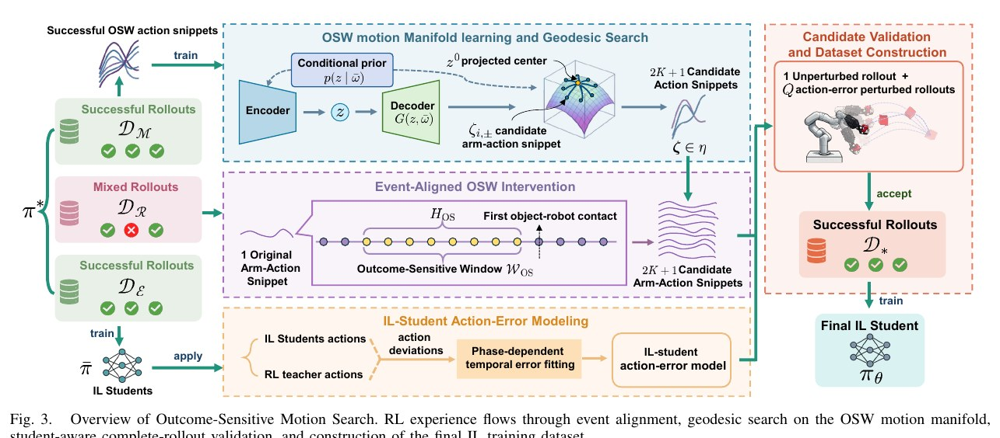
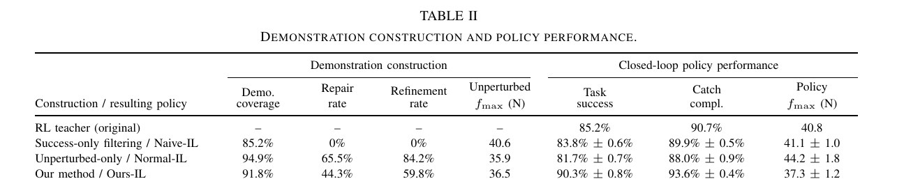
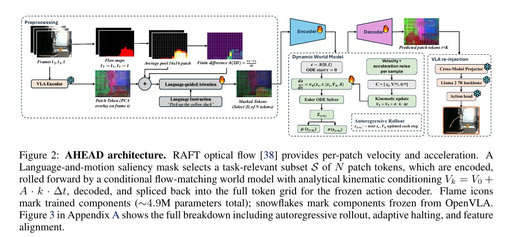
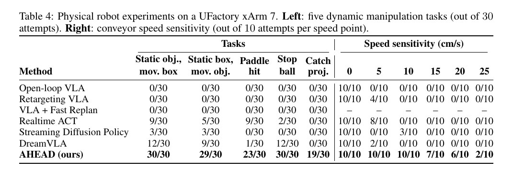
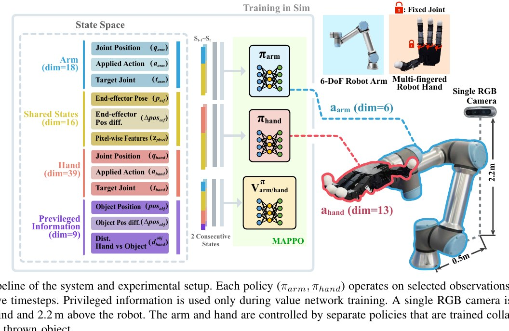
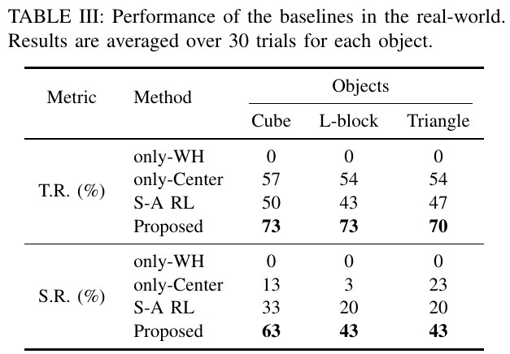

# Ego Catching Research Radar · 2026-10-20

本期 3 篇全文精读、4 组补充资源。
Outcome-Sensitive Motion Search for Impact-Aware Dexterous Catching：论文针对机械臂手系统接捕高速飞行物时的碰撞冲击抑制与抓取留存问题，将接捕任务形式化为在接触前关键时间窗口（OSW）内寻找兼具低冲击峰值与动作执行鲁棒性的运动修正解。证据边界：整个验证完全局限在刚体仿真环境中，未能提供任何实体机器人的真实抓捕试验数据。
Intercepting the Future: Latent-Space Predictive World Model for Dynamic VLA Manipulation：针对动态场景中物体自主运动导致静态VLA策略因感知与执行延迟而抓空的问题，提出在冻结参数的7B VLA外层包裹轻量级预测世界模型（AHEAD）。证据边界：该系统依赖单目 2D 光流与恒定加速度假设，未验证具有显著视轴深度（Z轴）运动或复杂 3D 旋转轨迹时的预测有效性；若能在物理硬件上补充带有大范围纵深运动的抛体或弹跳物体抓取观测，并对比不同相机视角的预测误差，方能确认该运动先验在 3D 空间的适用边界。
Pixel2Catch: Multi-Agent Sim-to-Real Transfer for Agile Manipulation with a Single RGB Camera：针对人类抛掷物体的动态接取问题，该工作旨在控制配备多指灵巧手的机械臂，在不依赖显式3D位置估计的前提下实现接触拦截与稳定抓取。证据边界：真实实验中的抛物轨迹由人工抛掷生成，缺乏对抛掷速度、入射角度、释放距离等动态边界条件的客观量化与统计记录。

## 1. Outcome-Sensitive Motion Search for Impact-Aware Dexterous Catching

**作者：** Guorui Pei, Jinsong Wu, Songyuan Su, Jiaming Qi, Sichao Liu, David Navarro-Alarcon, Bin Liu, Peng Zhou
**单位：** Taiyuan University of Technology; The Hong Kong Polytechnic University; Southern University of Science and Technology; Great Bay University; Northeast Forestry University; KTH Royal Institute of Technology; Kaiyang Laboratory, Chery Automobile Co., Ltd.
**发表与版本：** arXiv preprint · 2026-09-24

**选题定位：** 核心相关工作

[arXiv](https://arxiv.org/abs/2609.29020v1) · [PDF 下载](https://arxiv.org/pdf/2609.29020v1)

### Problem formulation

论文针对机械臂手系统接捕高速飞行物时的碰撞冲击抑制与抓取留存问题，将接捕任务形式化为在接触前关键时间窗口（OSW）内寻找兼具低冲击峰值与动作执行鲁棒性的运动修正解。系统目标是在满足接触前相对速度下限、法向接触力峰值约束与迎向跟随位移前提下，维持抓取稳定至少1.0秒；核心假设是接触前短时间窗口内的机械臂动作微调对下游碰撞与抓取成败具有决定性非均匀影响，且特权强化学习专家的失败样本可通过流形搜索局部修复。

**观测与动作／训练和部署的区别：** 仿真平台为MuJoCo，机器人实体为7自由度xArm7机械臂与17自由度ORCA灵巧手（共24自由度），控制频率为50 Hz。感知方面，特权RL教师拥有仿真器完整真值状态（包含物块及手部各连杆位姿、线/角速度与瞬时接触力）；而最终部署的模仿学习（IL）学生策略仅接收时序可部署观测历史、上一时刻动作以及当前物体空间位置（作为唯一的物体状态输入），不依赖特权接触信息。动作输出为24维归一化关节控制量，采用长度为8步的action chunk预测并每步重规划执行第1步。

### Pipeline 与关键方法

图3展示了结果敏感运动搜索（Outcome-Sensitive Motion Search）的完整框架：包含事件对齐确定关键窗口（OSW）、在条件流形上利用拉回度量进行局部测地线搜索生成候选动作片段、基于拟合的学生执行误差模型进行全轨迹鲁棒性验证，以及最终构建用于训练可部署IL学生策略的高质量数据集流程。
[原图来源：Fig. 3](https://arxiv.org/pdf/2609.29020v1#page=3)

| 模块 | 输入 → 输出 | 关键方法与作用 |
|---|---|---|
| 事件对齐与OSW提取 | 输入特权RL教师的完整轨迹 -> 输出截取的OSW机械臂动作片段及起始特权状态 | 以首次接触或掌心最近距离时间步对齐提取接触前8个控制步（约160 ms）的机械臂动作片段 |
| 流形学习与测地线搜索 | 输入原始OSW片段与初始状态 -> 输出2K+1（9个）候选机械臂动作片段 | 训练条件变分自动编码器学习成功动作流形，并在拉回度量诱导的黎曼流形上沿Sobol切向量进行测地线搜索生成9个候选动作片段 |
| 学生误差建模与全轨迹验证 | 输入候选动作片段与扰动误差模型 -> 输出验证通过的高质量示范轨迹数据集 | 利用自回归时序误差模型拟合交叉训练学生与教师的偏差，执行1次无扰动加16次扰动完整仿真回放，筛选同时满足抓取、冲击约束与鲁棒性阈值的候选片段 |
| 条件流匹配学生策略训练 | 输入可部署观测历史 -> 输出预测的24维机械臂与灵巧手动作块 | 使用构建的数据集训练基于条件流匹配（Conditional Flow Matching）的动作分块模仿策略 |

**训练数据与监督：** RL教师采用PPO算法在MuJoCo中训练，奖励函数结合接捕、抓取留存、速度匹配、峰值冲击力惩罚与跟随位移项；域随机化覆盖物块质量（0.04-0.06 kg）、发射位置与初速度（2.8-5.0 m/s）、观测/动作延迟、执行噪声与接触动力学。示范构建阶段利用20,000条成功轨迹训练CVAE流形，20,000条校准学生误差，并在20,000条混合轨迹上进行修复与精炼。最终IL学生采用条件流匹配架构，由清洗并扩充的99,328条扰动验证成功轨迹监督训练。

### 实验结果及分析

表2给出了示范数据构建指标与闭环策略性能的定量对比：本方法（Ours-IL）在测试集上取得了90.3%的任务成功率与37.3 N的最低平均接触峰值力，不仅超越特权教师（85.2%, 40.8 N），而且显著优于未考虑误差扰动的Normal-IL（81.7%, 44.2 N），说明更高的无扰动示教覆盖率并不能直接转化为闭环鲁棒性。
[原图来源：Table II](https://arxiv.org/pdf/2609.29020v1#page=8)

- 引入速度匹配与跟随位移后，特权RL教师在接捕完成率相近（90.7% vs 92.5%）的情况下，任务综合成功率由0.4%提升至85.2%，峰值冲击力从160.1 N下降74.5%至40.8 N。 Section V-B, Table I [原文](https://arxiv.org/pdf/2609.29020v1)
- Ours-IL学生闭环任务成功率达到90.3% ± 0.8%，分别超过特权RL教师5.1个百分点、朴素IL（Naive-IL）6.5个百分点，同时将峰值冲击力降至37.3 ± 1.2 N；而仅基于无扰动验证的Normal-IL尽管示范覆盖率达94.9%，闭环成功率却仅为81.7% ± 0.7%。 Section V-C, Table II [原文](https://arxiv.org/pdf/2609.29020v1)
- 消融实验表明，在保持动作搜索半径一致时，完全测地线搜索的修复率达到44.3%、精炼率达59.8%，显著高于直接动作扰动（5.6% / 8.3%）与欧氏距离流形搜索（39.6% / 51.9%）。 Section V-E, Candidate generation paragraph [原文](https://arxiv.org/pdf/2609.29020v1)
- 误差模型消融中，考虑捕获阶段划分与时序自相关的模型（Phase-wise correlated）取得最低的一阶自相关误差（0.041），使学生策略成功率达到90.3%，高于忽略时序相关的阶段独立模型（86.8%）和全局高斯模型（82.2%）。 Section V-E, Table III [原文](https://arxiv.org/pdf/2609.29020v1)

实验充分支持了两个核心推论：第一，单纯提高示教数据的无扰动覆盖率（如Normal-IL达到94.9%覆盖率）会导致学生面临严重的协变量偏移，在闭环中甚至劣于直接成功过滤的Naive-IL（81.7% vs 83.8%），证明必须引入面向部署端动作误差的鲁棒性验证机制；第二，针对碰前短时间窗口（OSW）的局部动作流形精炼与修复，能够有效弥补特权教师在临界碰撞动态下的次优表现。局限性在于：该方法完全依赖仿真器内刚体与接触碰撞模拟，所有搜索和误差模型均基于MuJoCo物理引擎，缺乏对真机视觉遮挡、时延抖动及相机运动模糊的验证；此外，修复能力严格受限于所学流形的支持集，对完全超出流形覆盖的大偏差无法修复。

### Robotics reviewer judgment

- **实际贡献：** 该方法针对动态抓捕的冲击缓解问题，提出了一种示范数据构建框架：在接触前的结果敏感窗口（OSW）内，基于条件变分流形与拉回度量测地线搜索生成候选手臂动作以修正或优化RL教师轨迹，并利用校准的阶段相关学生动作误差模型通过完整仿真仿真步进行候选验证与筛选。
- **最强证据：** 最直接的定量证据来自MuJoCo仿真环境中7自由度机械臂配合17自由度灵巧手的抓捕任务，在10类物体外形与初始扰动下，最终训练的模仿学习策略在仿真闭环评估中达到了90.3%的任务成功率和37.3 N的峰值接触力，优于特权RL教师的85.2%和40.8 N。
- **证据缺口：** 整个验证完全局限在刚体仿真环境中，未能提供任何实体机器人的真实抓捕试验数据。需要观察在真实相机感知延迟、手眼标定误差以及未建模物理接触反弹条件下，该离线动作误差模型与仿真筛选出的轨迹能否在真实机械臂-灵巧手上成功完成柔顺抓捕。
- **比较是否公平：** 论文对比主要为内部构建机制的消融（包括不同误差模型、搜索方式以及Naive-IL与Normal-IL），未完整复现对比文献中已发表的独立非抢占式或动态抓捕系统。结果展现了明确的性能权衡：仅依赖无扰动验证的Normal-IL在离线时获得了最高的数据覆盖率（94.9%），但在闭环测试中因忽略执行漂移而成功率垫底（81.7%）；完整的误差验证将修复率降至44.3%，换取了更高的闭环成功率。
- **总体判断：** 论文在仿真层面上充分支持了通过敏感窗口流形搜索结合执行误差筛选能有效提高模仿学习闭环表现的推论。但鉴于其仅对前向手臂动作进行开环介入且完全缺乏真实硬件验证，其对真实世界动力学不确定性和复杂接触摩擦的适用性仍有待检验。

**对 OpenArm 的启发与最小实验：** 该方案对OpenArm/OpenArmX在机载感知下的动态接捕具有直接的方法论借鉴价值：其一，针对OpenArm由于电机反冲或机械刚度限制可能面临的撞击反弹问题，OSW的速度匹配与顺应跟随动作流形可直接用于优化机械臂的抓取前轨迹；其二，OpenArm实机运行视觉感知算法时常存在不可忽略的延迟与抖动，论文中的阶段自回归动作误差模型可直接用来模拟OpenArm机载位姿估计算法的时延扰动，从而在仿真中筛选出对OpenArm视觉时延鲁棒的示范轨迹。最小实验建议：在OpenArm MuJoCo模型中加入机载单目相机的帧延迟与卡尔曼滤波输出噪声，利用该文框架提取接触前5-8步的末端速度匹配补偿策略，对比标准RL蒸馏策略的接捕成功率与反弹跌落率。

## 2. Intercepting the Future: Latent-Space Predictive World Model for Dynamic VLA Manipulation

**作者：** Shahram Najam Syed, Arthur Jakobsson, Haoran Hao, Jeffrey Ichnowski
**单位：** Robotics Institute, Carnegie Mellon University
**发表与版本：** 10th Conference on Robot Learning (CoRL 2026) · 2026-10-03

**选题定位：** 已有论文的新版本

[arXiv](https://arxiv.org/abs/2606.02486v2) · [PDF 下载](https://arxiv.org/pdf/2606.02486v2)

### Problem formulation

针对动态场景中物体自主运动导致静态VLA策略因感知与执行延迟而抓空的问题，提出在冻结参数的7B VLA外层包裹轻量级预测世界模型（AHEAD）。给定单目RGB观测 $o_t$ 和语言指令 $\ell$，冻结的视觉编码器生成 $N$ 个patch tokens $v_t \in \mathbb{R}^{N \times d}$，AHEAD在前向传播中预测未来 $K$ 步的任务相关patch tokens $\hat{v}_{t+K}$ 并回填至特征网格，交由冻结的动作解码器输出控制指令 $a_t = \pi(\hat{v}_{t+K}, e_\ell)$。核心假设是预测视界内物体的运动满足一阶恒加速度/恒速度局部运动学近似，目标是在单步约200 ms的反应时延预算内完成预测并驱动机械臂实施拦截与抓取。

**观测与动作／训练和部署的区别：** 输入感知为单目固定第三人称RGB相机（物理实验为Intel RealSense D435，安装于底座前方约1.2 m的三脚架上，图像下采样至224×224，仅使用RGB流，未使用深度图），仿真为MuJoCo内固定第三人称RGB渲染；不依赖本体感受输入至世界模型（仅Realtime ACT等基线输入本体感受）。部署与评估阶段均无需外部动作捕捉系统或Marker标记；仿真演示采集依赖特权状态规划器（每场景500条），真机微调使用实验室自采的约200条动静态混合轨迹。执行机构在仿真中为7自由度Franka Emika Panda配平行双指夹爪，真机为7自由度UFactory xArm 7，末端配备平行双指夹爪、乒乓球拍或网兜附件；动作指令以30 Hz输出执行。

### Pipeline 与关键方法

AHEAD系统总览图（论文Figure 2）：展示从三连续帧光流计算与有限差分加速度提取、语言/运动联合显著性Token稀疏掩码、紧凑隐空间条件流匹配（CFM）多步外推、解析运动学更新，到Token空间拼接及注入冻结OpenVLA解码动作的端到端数据流。图示清晰呈现了4.9M可学习模块与冻结VLA组件的解耦关系。
[原图来源：Figure 2](https://arxiv.org/pdf/2606.02486v2#page=4)

| 模块 | 输入 → 输出 | 关键方法与作用 |
|---|---|---|
| 稠密光流与逐Token运动学估计 (Motion Estimation) | 输入: 连续3帧RGB图像 $o_{t-2:t}$ 与视觉token $v_t$；输出: 附带运动矢量的特征token $\tilde{v}_t$。 | 通过RAFT计算连续三帧 ($o_{t-2}, o_{t-1}, o_t$) 的双向稠密光流场，经16×16 patch平均池化获取每个token的二维瞬时速度 $V_i$，并利用一阶有限差分得到加速度 $A_i$，拼接形成运动增强token $\tilde{v}_t \in \mathbb{R}^{N \times (d+4)}$。 |
| 空间自适应算力分配 (Language-and-Motion Saliency) | 输入: 运动增强token $\tilde{v}_t$ 与语言嵌入 $e_\ell$；输出: 选定显著token子集 $\tilde{v}_t^{(S)}$ (约30~60个)。 | 通过交叉注意力将 $\tilde{v}_t$ 映射至语言嵌入 $e_\ell$ 获得语义显著度得分，结合速度模长阈值门控 $\max(\tilde{M}_i, \alpha_{\text{motion}} \cdot \mathbf{1}[\\|V_i\\| > \tau_{\text{flow}}])$ 与单token形态学膨胀，筛选出30至60个动态或任务相关token子集 $S$。 |
| 显式运动学条件流匹配前向推演 (Flow-Matching World Model) | 输入: 压缩隐变量 $z_t$ 与解析更新的运动学参数；输出: 未来状态隐变量样本集 $\{z_{t+k}^{(j)}\}_{j=1}^5$。 | 4层Transformer将选中token压缩为紧凑隐变量 $z_t \in \mathbb{R}^{256}$；采用条件流匹配 (CFM) 与5步Euler ODE求解器自回归推演未来状态，每步推演通过解析公式 $V_k = V_0 + A \cdot k \cdot \Delta t$ 显式注入速度外推条件，并叠加高斯噪声并行生成 $S=5$ 条样本轨迹。 |
| 时间自适应视界截断 (Adaptive Horizon Halting) | 输入: 并行样本轨迹；输出: 动态自适应视界截断步数 $K$ 及未来隐变量 $z_{t+K}$。 | 实时计算 $S=5$ 个流匹配轨迹样本在选中token上的均方差方差 $\bar{u}_{t+k}$ 作为预测不确定性指标；当方差超过训练集90分位阈值 $\tau_u$ 或达到最大上限 $K_{\max}=10$ 时立即终止推演，防止碰撞后发散误差累积。 |
| 特征重构、空间拼接与对齐重注入 (Decoder & Splice) | 输入: 未来隐变量 $z_{t+K}$ 与当前token $v_t$；输出: 拼接对齐后的完整未来特征网格 $\hat{v}_{t+K}$ 与控制动作 $a_t$。 | MLP解码器将 $z_{t+K}$ 还原为patch维度，经两层MLP特征对齐层 $g_{\text{align}}$ 校准至动作解码器敏感流形，并回填至原始静态网格的 $S$ 位置（未选定背景保持当前帧token），送入冻结的OpenVLA生成动作。 |

**训练数据与监督：** 分为三阶段：(1) 世界模型预训练：使用约65.6万条公开操作视频（EPIC-Kitchens、Something-Something V2、DROID、Bridge V2、CALVIN、OXE xArm子集），对第一人称视频进行单应矩阵对齐去除自动，经三阶段课程学习（简单直线运动 -> 旋转多目标 -> 全数据集距离加权混合），以条件流匹配目标与未来 $K_{\text{train}}=8$ 步的特征MSE重建损失联合优化编码器、CFM动力学与解码器（8×H100，20万步，约96 GPU小时）；(2) 特征对齐层独立训练：冻结世界模型与OpenVLA，在验证集配对样本上以真机动作解码器的预测动作误差 $L_{\text{align}} = \|\pi(g_{\text{align}}(\hat{v}_{t+k}), e_\ell) - \pi(v_{t+k}, e_\ell)\|^2$ 为监督，训练轻量两层MLP残差网络（1×H100，约4 GPU小时）；(3) 真实机器人微调：在实验室采集的约200条xArm 7静态操作与动态视频片段上微调5个epoch（1×H100，约2 GPU小时）。基线DreamVLA同样基于等量资源与相同数据进行微调。

### 实验结果及分析

UFactory xArm 7物理真机实验结果表（论文Table 4）：左侧统计了5项高动态物理操作任务中30次尝试的成功次数，AHEAD在高速抛体抓取（Catch proj.）中达成19/30，而所有基线均为0/30；右侧展示了传送带速度从0至25 cm/s的敏感性扫描（每点10次），证实基线在速度超过5 cm/s后近乎完全失效，而AHEAD在25 cm/s极限下仍保留拦截能力。
[原图来源：Table 4](https://arxiv.org/pdf/2606.02486v2#page=8)

- 在MuJoCo动力学仿真的恒速与加减速两大类场景中（5个随机种子，每种子100次rollout，共500次），AHEAD在传送带（97.3±1.5%恒速 / 87.7±3.3%加速）、滑轨（91.7±2.8% / 91.0±3.9%）、推杆（95.0±2.3% / 93.7±6.1%）和滚球（90.0±3.1% / 89.0±0.9%）全部8组测试中均取得最高成功率，而最强基线DreamVLA在加减速场景仅为30.7%~48.0%，传统追踪基线Track-and-Intercept为63.6%~74.8%。 Table 1 (Page 7) [原文](https://arxiv.org/pdf/2606.02486v2#page=7)
- 在传送带杯子抓取的物体速度敏感性扫描实验中（0~40 cm/s，500次rollout/点），静态（0 cm/s）各模型表现接近（AHEAD 97.6±1.5%，DreamVLA 96.8±1.8%，ACT 97.2±1.6%）；但当速度上升至40 cm/s时，反应式策略大幅退化（ACT降至41.0%，Streaming DP降至18.6%，DreamVLA降至47.2%），AHEAD仍保持95.4±2.2%的成功率。 Table 2 (Page 7) [原文](https://arxiv.org/pdf/2606.02486v2#page=7)
- 在8个复杂动态仿真任务中（遮挡、空中弹道拦截、多球多目标等，500次rollout/项），AHEAD在弹道抓取 (BC) 达87.4±3.2%，遮挡抓取 (Occ) 达79.4±3.8%，中途变向 (Mid) 达94.4±2.4%；作为对比，无显式预测的基线（Retargeting VLA、VLA+Fast Replan、Streaming DP）在遮挡任务中成功率均为0.0%，Realtime ACT仅11.4±3.0%。 Table 3 (Page 8) [原文](https://arxiv.org/pdf/2606.02486v2#page=8)
- 在UFactory xArm 7物理真机测试中（每项任务30次尝试），AHEAD在静态物放移动盒 (30/30)、移动物放静态盒 (29/30)、乒乓球拍击打拦截 (23/30)、停滚球 (30/30) 均大幅领先；在2米弹簧发射器抛体抓球任务中取得19/30成功率，而所有对比基线（Open-loop、Retargeting、ACT、Diffusion Policy、DreamVLA）在该抛体抓球任务中全部为0/30。 Table 4 (Page 8) [原文](https://arxiv.org/pdf/2606.02486v2#page=8)
- 物理传送带调速实验（0~25 cm/s，每点10次）：速度在10 cm/s时所有基线全部归零（仅Streaming DP获3/10），而AHEAD在0、5、10 cm/s均为10/10，15 cm/s为7/10，20 cm/s为6/10，25 cm/s仍实现2/10。 Table 4 (Page 8) [原文](https://arxiv.org/pdf/2606.02486v2#page=8)
- 在混沌弹跳应力测试（Plinko Drop，钉板下落随机偏折）中，低阶运动学假设被破坏，在1600 ms反应窗口下AHEAD成功率降至48.6±4.7%，但仍显著高于最佳基线Realtime ACT的17.8±3.8%与DreamVLA的12.6±3.2%。 Table 11 (Page 27) & Table 16 (Page 30) [原文](https://arxiv.org/pdf/2606.02486v2#page=27)
- 单步控制延迟基准评测：在NVIDIA H100上AHEAD端到端重规划耗时约158 ms（RAFT 20ms、流匹配推演40ms、VLA并行解码70ms等），在RTX 4090物理控制机上实测为171 ms，均处于约200 ms的人类反应时延和操作窗口内。 Table 6 (Page 17) & Section 5.1 (Page 6) [原文](https://arxiv.org/pdf/2606.02486v2#page=17)

实验强有力地支持了核心论点：在物体发生不可控的自主动态位移时，单纯依靠高频重规划或动作分块（如Realtime ACT或Streaming DP）无法消除视觉感知与执行之间的固有延迟滞后，策略在高速下必然抓向物体过去的位置；而通过在潜在特征空间中利用显式运动学引导进行前向状态预测（Predict-then-act），能够有效补偿该滞后并击中未来拦截点。遮挡实验（Occ达到79.4% vs 反应式基线全为0%）清晰证明了预测机制与反应机制在认知结构上的本质差异。然而，该机制也有明确适用边界：(1) 它高度依赖恒加速度运动学假设，在Plinko等高频碰撞与混沌非线性场景下，预测方差迅速触发截断，成功率退化至48.6%；(2) 物理真机抛体抓取的11次失败中，有5次源于末端逆解被安全关节限位截断（几何上可达但构型不可达），另有6次由于到达时间略滞后或球撞击网兜边缘弹出，暴露出单纯端到端视觉前向推演缺乏对机械臂全身动力学可行域（kinodynamic reachability）与接触碰撞能量吸收的闭环阻尼控制。

### Robotics reviewer judgment

- **实际贡献：** 该方法提出了名为 AHEAD 的外挂式预测模块（约 4.9M 参数），在不重训 7B 冻结 VLA 的前提下，利用光流估计的 patch 级速度与加速度进行条件约束，通过条件流匹配（conditional flow matching）在潜在特征空间外推未来 token，并利用语言-运动显著性掩码与不确定性截断将预测限制在实时控制延迟预算内。
- **最强证据：** 最直接的物理验证在单台 UFactory xArm 7 与单目固定三视角 RGB 相机（RTX 4090 离线/板外计算，171 ms 单步延迟）上完成，在包含输送带、阻挡滚球、球拍击球与发射器接球的 5 项真实动态任务中，接球任务取得 19/30 成功率（基线均为 0/30），且在仿真 20 个动态场景中均有量化评测。
- **证据缺口：** 该系统依赖单目 2D 光流与恒定加速度假设，未验证具有显著视轴深度（Z轴）运动或复杂 3D 旋转轨迹时的预测有效性；若能在物理硬件上补充带有大范围纵深运动的抛体或弹跳物体抓取观测，并对比不同相机视角的预测误差，方能确认该运动先验在 3D 空间的适用边界。
- **比较是否公平：** 论文对比了外部已发表系统（如 Realtime ACT、Streaming Diffusion Policy、DreamVLA 及迁移特征空间的 LaDi-WM）与像素级追踪基线，并针对光流源、掩码和预测步长进行了组件消融；权衡上，AHEAD 依靠预测未来跨越了延迟盲区，但流计算与多次采样使单步推断耗时（约 158~171 ms）显著高于反应式基线（12~95 ms），且在机械臂受限于关节速度保护时仍会出现因来不及运动到拦截点而失败的情况。
- **总体判断：** 实验数据充分支持在平面主导且符合恒定加速度假设的动态物体拦截任务中，潜在空间预测能有效弥补冻结 VLA 的感知执行延迟；但对于混沌碰撞（如仿真 Plinko 任务成功率显著下降）、深度方向显著变化以及相机自身移动（手眼相机产生自身运动光流）等场景，该方法的有效性仍未得到证实。

**对 OpenArm 的启发与最小实验：** 对OpenArm/OpenArmX原型机的动态感知与拦截具有直接的架构借鉴价值：(1) OpenArm目前若使用低成本单目RGB与较重的前向视觉Backbone，极易因100~300 ms的推理时延导致动态抓取失败；AHEAD的即插即用预测外挂可在无需重新采集数千条示教的情况下直接赋能现有抓取策略；(2) 空间显著性掩码机制极为关键，可避免在嵌入式算力（如Orin）上对整幅图像进行扩散或推演；(3) 需针对OpenArm进行适配与验证的缺陷：OpenArm若采用手眼相机（Eye-in-Hand），需增加基于机械臂正运动学（FK）的自运动光流对消补偿模块；此外，OpenArm执行机构存在背隙与扭矩限制，论文中抛体拦截由于关节限位导致失败的现象提示我们，在为OpenArm生成预测目标时，必须引入工作空间可行拦截流形（Feasible Interception Set）校验，避免生成动力学不可达的越界指令；(4) 建议最小验证实验：在固定底座OpenArm仿真中搭建一条0~25 cm/s的传送带或斜坡滚球环境，接入AHEAD作为OpenVLA外挂，对比开环、纯闭环与预测前馈在不同延迟注入下的抓取成功率。

## 3. Pixel2Catch: Multi-Agent Sim-to-Real Transfer for Agile Manipulation with a Single RGB Camera

**作者：** Seongyong Kim, Junhyeon Cho, Kang-Won Lee, Soo-Chul Lim
**单位：** Dongguk University
**发表与版本：** IEEE Robotics and Automation Letters (RA-L) 2026 / arXiv preprint · 2026-02-26

**选题定位：** 旧文补读

[arXiv](https://arxiv.org/abs/2602.22733v1) · [PDF 下载](https://arxiv.org/pdf/2602.22733v1) · [Project](https://seongdrgn.github.io/pixel2catch/) · [Code](https://github.com/seongdrgn/pixel2catch-github)

### Problem formulation

针对人类抛掷物体的动态接取问题，该工作旨在控制配备多指灵巧手的机械臂，在不依赖显式3D位置估计的前提下实现接触拦截与稳定抓取。系统仅以单目RGB图像提取的图像空间边界框特征及机器人本体感觉为状态输入，输出机械臂关节位置增量与灵巧手目标关节位置。优化目标是在物体坠落前通过多智能体协作最大化贴近奖励与抓取成功回报，核心假设是物体在图像平面的质心偏移与尺度变化率能够隐式反映物体在三维空间中的运动轨迹与逼近速度。

**观测与动作／训练和部署的区别：** 部署感知仅使用单个固定在机器人后上方（距机器人底座后方0.5m、上方2.2m）的Intel RealSense D435单目RGB相机（无深度流）与机器人关节本体感觉（臂6维、手13维位置及上一时刻动作与末端位姿）；训练时使用Isaac Lab环境特权状态（物体3D坐标、速度及手部-物体欧氏距离）辅助值网络学习，测试与真机部署完全移除特权状态与外部动捕。动作输出包含机械臂关节目标增量（6维，接PD控制）和灵巧手关节绝对目标角（13维，Allegro Hand固定3个关节以保证抓取刚性），策略控制频率为30Hz（仿真物理循环120Hz，抽取率为4）。需特别注意：相机为外部第三人称全局视点，而非装配在机械臂末端的Eye-in-Hand机载相机。

### Pipeline 与关键方法

Pixel2Catch系统流水线与仿真/真实实验布局概览。左侧展示状态空间构建：包含机械臂（18维）、灵巧手（39维）的专属本体感觉及连续两帧拼接的共享状态（16维，含末端位姿及6维像素级运动特征z_pixel），特权信息（9维，物体真值位姿与距离）仅在训练期输入中心化值网络；中间展示基于MAPPO的异构策略分解（π_arm输出6维动作控制UR5e，π_hand输出13维动作控制Allegro Hand）；右侧展示单目RGB相机架设于机器人后上方（高2.2m、后偏0.5m）的第三人称全局视点布局。
[原图来源：Fig. 2](https://arxiv.org/pdf/2602.22733v1#page=3)

| 模块 | 输入 → 输出 | 关键方法与作用 |
|---|---|---|
| 视觉目标分割与特征提取 | 输入单路RGB图像帧，输出目标在图像空间的归一化中心坐标、宽高及其相邻两帧的时域差分特征向量 z_pixel = {cx, cy, Δcx, Δcy, Δw, Δh} ∈ R^6 | SAM 2 (Segment Anything Model 2) 跟踪分割 + 像素级边界框几何计算 |
| 异构多智能体协同决策 | 输入拼接连续2帧的时序观测（包含本体状态、末端位姿、动作历史及共享z_pixel），机械臂策略π_arm输出6维关节增量a_arm，灵巧手策略π_hand输出13维关节目标a_hand | 分工解耦的MAPPO (Multi-Agent PPO) 策略网络 (CTDE范式) |
| 关节级低层运动执行 | 输入两组策略动作输出，映射为UR5e与Allegro Hand的30Hz电机执行位置指令 | PD控制器增量位置跟踪与关节限位重映射 |

**训练数据与监督：** 在NVIDIA Isaac Lab中搭建仿真环境，通过对真机执行多样化关节轨迹记录并优化仿真致动器增益、阻尼、摩擦力与电枢参数完成系统辨识（System ID）；采用MAPPO框架在2张NVIDIA RTX A6000上进行512个环境的并行训练，Actor与Critic均为3层MLP（512-256-128，ELU激活）；训练期间对边界框角点施加最多5像素的随机扰动以模拟真实分割噪声，并在关节刚度/阻尼（臂0.8~1.2倍、手0.7~1.3倍）、动作噪声（臂σ=0.03、手σ=0.02）、观测噪声（σ=0.005）、物体质量（0.5~1.5倍）及恢复系数（0.0~0.5）上实施广泛域随机化；Critic使用物体真实三维距离与位姿等特权信息，Actor仅使用无特权时序观测，实现零样本Sim-to-Real直接迁移。

### 实验结果及分析

实物部署中各基线方法在人类抛掷三种不同几何体（Cube、L-block、Triangle）下的性能对比（每种物体评测30次）。表中量化了手掌接触目标的跟踪率（T.R. %）与成功捕获并保持不坠落的成功率（S.R. %）。所提方法在全部三类物体上均取得最高拦截与抓取表现（S.R.达43%~63%）；消融基线only-Center因缺少尺度变化信息而在真实场景中严重退化（S.R.降至3%~23%），单智能体S-A RL在实物扰动下表现不稳（S.R.仅20%~33%），而only-WH完全无法形成有效接取。
[原图来源：TABLE III](https://arxiv.org/pdf/2602.22733v1#page=7)

- 在仿真测试中，所提方法在已知物体上的跟踪率（T.R.）为89.97±0.21%，成功率（S.R.）为84.13±0.50%；在未知物体上T.R.为89.28±0.79%，S.R.为84.83±1.17%，显著高于单智能体基线S-A RL（未知物体T.R. 75.83±2.00%，S.R. 65.44±2.25%）与仅中心基线only-Center（未知物体S.R. 80.72±0.38%），而无像素特征基线w/o-PF仅达7.89±1.46%成功率（3个随机种子平均）。 Section V-B, Table II, Page 6 [原文](https://arxiv.org/pdf/2602.22733v1#page=6)
- 在人类抛掷真实物体（Cube、L-block、Triangle）的30次实物试验中，所提方法平均跟踪率约70%（Cube 73%、L-block 73%、Triangle 70%），抓取成功率达43%~63%（Cube 63%、L-block 43%、Triangle 43%）；相比之下，单智能体S-A RL成功率仅为20%~33%，only-Center由于缺乏尺度信息引发手部振颤导致成功率暴跌至3%~23%，而only-WH完全无法拦截（T.R.与S.R.均为0%）。 Section V-D, Table III, Page 7 [原文](https://arxiv.org/pdf/2602.22733v1#page=7)

实验证实：单目RGB图像中提取的中心漂移率与宽高变化率足以提供拦截所需的相对视线角速度与逼近距离线索，结合SAM 2的高鲁棒性分割与边界框噪声随机化，可摆脱昂贵的3D深度相机或动捕系统；臂-手异构分工（臂负责拦截引导，手负责自适应闭合）相比单智能体端到端强化学习具有更明确的奖励信号与更低的表示退化风险，真实迁移时更抗扰动。然而实验局限显著：其一，相机固定于全局高位，视角稳定且视场全覆盖，未面临机械臂本体遮挡或相机随臂剧烈摆动带来的动态畸变与自运动位移；其二，由于单目尺度推断严重依赖目标先验尺寸与宽高变化率，面对大形变非刚体或自旋剧烈的扁平物体时，边界框变化将混淆逼近距离与姿态旋转，导致拦截窗口计算失准；其三，实物评测仅30次抛掷/物体，缺乏击中但掉落的详细滞留时长与接触力冲击量化。

### Robotics reviewer judgment

- **实际贡献：** 该方法提出了一种基于单目RGB相机的动态抓接框架，利用SAM 2提取物体在图像空间的中心坐标、宽高及其时序差分特征以隐式表征运动，避免了显式三维位置估计。同时，该方法将机械臂定位与多指手抓取解耦为异构双智能体，通过设定角色特定的观测与奖励并结合MAPPO算法进行单阶段强化学习训练。
- **最强证据：** 最直接的证据体现在真实世界动态抓接实验中：系统在未经过真实环境微调的情况下，仅依赖单目RGB相机在离线辨识与域随机化支持下，对人类抛出的立方体、L型块和三角块实现了43%至63%的抓取成功率以及70%至73%的手掌接触跟踪率。
- **证据缺口：** 真实实验中的抛物轨迹由人工抛掷生成，缺乏对抛掷速度、入射角度、释放距离等动态边界条件的客观量化与统计记录。若要确证其应对真实动态变化的稳健性，需要通过受控的机械发射装置在明确的速度与落点方差范围内进行测试，并补充相机端SAM 2推断延迟对抓接成功率影响的分析。
- **比较是否公平：** 论文仅对比了内部消融变体（无像素特征、仅中心坐标、仅尺寸特征）以及单智能体PPO基线，并未复现或对比文献中提及的基于RGB-D或轨迹预测的具名外部基线系统。实验表明，单目二维特征在缺失宽度与高度信息时真实世界成功率会骤降至3%至23%，且实机抓取成功率（43%-63%）相比仿真环境（约84%）存在较大幅度的性能衰减。
- **总体判断：** 论文充分支持了在固定机外视角下，利用二维边界框特征与臂手解耦多智能体RL能够实现特定几何体动态抓接的论点。但由于缺少外部先进方法对比以及受控抛掷工况评估，该方法在复杂背景分割失真、剧烈光照变化及高速物体条件下的泛化能力仍属未决问题。

**对 OpenArm 的启发与最小实验：** 对OpenArm固定台架动态接物开发具有高度参考价值：1) 特征迁移可行性：OpenArm可借鉴其紧凑特征构建方案，将实时检测框的 {cx, cy, Δcx, Δcy, Δw, Δh} 与关节状态拼接，避免直接端到端输入高维像素导致的训练缓慢与域鸿沟；2) 控制架构借鉴：对于配备多指夹爪或灵巧末端的OpenArm，采用异构双智能体（臂跟踪目标+爪包络闭合）可有效降低统一动作空间的策略探索难度。但需注意关键证据缺口：OpenArm若采用机载眼在手上（Eye-in-Hand）相机，相机运动与物体运动在图像平面产生严重自运动耦合（Ego-motion coupling），像素位移不再单纯反映物体飞行，必须在状态输入中强引入机械臂正向运动学末端速度补偿；建议OpenArm初始验证实验：在固定底座的OpenArm上配置机头固定视角（相对于基座静止）RGB相机，复现其SAM 2边界框差分特征提取，对比单智能体与异构双智能体在气泡袋/软球抛接中的拦截命中率与收爪抓握保持率。

## 补充研究资源

### OpenArm Hardware Release 2.0.0

**形式：** code · **访问层级：** partial
**作者／单位：** enactic development team · enactic
**日期：** 2026-09-09

OpenArm 官方开源硬件仓库 2.0.0 标签发布，更新了包含 OpenArm 2.0 机械设计图纸与装配文档的 Google Drive 存储源，精简了归档文件路径结构。

**研究启发：** 为研究团队的 OpenArm / OpenArmX 仿真模型（MuJoCo/Isaac URDF）提供最新的连杆物理几何尺寸、质量分布和传感器安装孔位参考。

**中立判断：** 主要包含机械图纸文件与文档组织更新，未涉及电机底层驱动或固件变更，是硬件与仿真一致性校对的关键基础资料。

[Access](https://github.com/enactic/openarm_hardware/releases/tag/2.0.0) · GitHub 公开访问，无需认证，图纸与装配指引可直接下载。 本次仅核验到搜索/部分页面材料，未取得完整正文访问记录；原文细节需回到来源核对。

### conveyor-grasp-sim: Eye-in-Hand RGB-D Dynamic Grasping Simulation

**形式：** code · **访问层级：** metadata_only
**作者／单位：** HowardKe-UOB · University of Bristol
**日期：** 2026-09-25

基于 Unitree Z1 Pro 机械臂和腕部眼在手（Eye-in-Hand）RGB-D 相机，在仿真环境中利用强化学习实现对传送带动态运动物体的追踪与闭环抓取。

**研究启发：** 与 OpenArm 原型高度契合的机载相机动态抓取环境，提供了端到端机载深度观测建模、动态物体生成与闭环策略训练配置。

**中立判断：** 代码库结构专注于眼在手视场下的动态目标追踪与抓取，但目前处于开源早期，缺乏独立学术评测指标与真机验证报告。

[Access](https://github.com/HowardKe-UOB/conveyor-grasp-sim) · GitHub 公开仓库，代码可自由检出。

### visual_servo_project: Dynamic Target Tracking and Catching via CoppeliaSim and ViSP

**形式：** code · **访问层级：** metadata_only
**作者／单位：** treading-the-void · Open Source Community
**日期：** 2026-07-12

基于 CoppeliaSim 仿真平台与 ViSP 视觉伺服库，利用 ROS 节点构建的机械臂动态目标实时位姿跟踪与抛接抓取控制流水线。

**研究启发：** 提供了一套经典的几何视觉伺服（IBVS/PBVS）基线实现，可直接作为 OpenArm 学习型接取算法在跟踪精度与计算延迟上的对比基线。

**中立判断：** 经典视觉伺服方案在高速大幅度轨迹截击时容易受视场遮挡和动力学饱和限制，但其实现模块化，便于剥离视觉特征跟踪逻辑。

[Access](https://github.com/treading-the-void/visual_servo_project) · GitHub 公开项目，包含中文配置文档与仿真启动脚本。

### DynamicGraspLab: A Framework for Dynamic Grasping in Isaac Lab

**形式：** code · **访问层级：** metadata_only
**作者／单位：** xwx555 · Open Source Community
**日期：** 2025-12-22

基于 NVIDIA Isaac Lab 搭建的动态物体抓取仿真框架，支持多种运动轨迹物体的动态物理交互仿真与强化学习环境构建。

**研究启发：** 为 OpenArm 在现代 GPU 并行仿真平台搭建高吞吐策略训练任务提供了现成的环境配置模式与动态奖励函数模板。

**中立判断：** 持续维护并同步支持 Isaac Lab 最新版本，但环境默认偏向静态机身与外部观测，需要自行集成机载相机传感器插件。

[Access](https://github.com/xwx555/DynamicGraspLab) · GitHub 公开仓库，2026年9月有活跃提交更新。

---

**检索覆盖与限制：** 本期直接读取 10 个公开来源记录，取得 60 项论文元数据；来源为 arXiv API、GitHub 仓库搜索及配置的作者／项目页。元数据用于发现候选，精读使用实际下载的原始 PDF。社交媒体、talk、视频等仅覆盖来源实际公开的正文或链接，不代表全网监测；具体读取层级见各资源卡。

判断依据公开原文；论文报告结果不等于独立复现。内容由定时工作流辅助整理。
